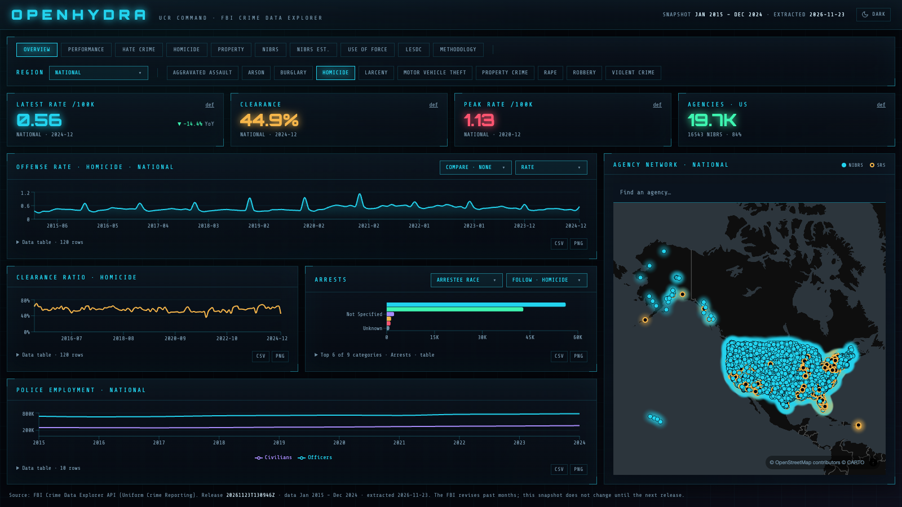

# OpenHydra

[](https://github.com/carloborodulin/OpenHydra/actions/workflows/ci.yml)
[](https://github.com/carloborodulin/OpenHydra)
[](https://fastapi.tiangolo.com/)
[](https://react.dev/)
[](https://www.getdbt.com/)
[](https://duckdb.org/)
[](https://openhydra-production.up.railway.app)
[](LICENSE)

OpenHydra is an end-to-end analytical data platform designed to process, analyze, and visualize crime statistics in the United States. The system consumes data from the Federal Bureau of Investigation (FBI) Crime Data Explorer (CDE) API, representing Uniform Crime Reporting (UCR) public statistics.

* **Live Platform Demonstration:** https://openhydra-production.up.railway.app
* **Upstream CDE API Documentation:** https://cde.ucr.cjis.gov/LATEST/webapp/#/pages/docApi
* **CDE API Access Registration:** https://api.data.gov/signup/



### Components

* **[cdeclient/](cdeclient/)**: a typed Python client and command-line tool for the CDE API. It validates each response and retries with a bounded policy.
* **[warehouse/](warehouse/)**: the extract (`oh-etl`) and the dbt models that build a DuckDB warehouse.
* **[analysis/](analysis/)**: a notebook about crime trends, clearance and arrests, and its [findings](analysis/FINDINGS.md).
* **[api/](api/)**: a FastAPI service. It serves the warehouse marts and proxies live agency data.
* **[web/](web/)**: a responsive React dashboard with a MapLibre agency map and Recharts charts.

The dashboard filters by the nation, a state (the 50 states and Washington D.C.) or one agency. The warehouse holds national and state rows. Agency rows come live from the CDE API through the API service, because the project does not store data for about 19,600 agencies.

## System architecture

```
web/        React + Vite + TypeScript dashboard (MapLibre GL, Recharts)
   │ REST/JSON
api/        FastAPI service over the warehouse, plus a live agency proxy
   │ SQL (read-only)
warehouse/  DuckDB database built by dbt from Parquet extracts
analysis/   Notebook (Polars + Plotly) over the same warehouse
   │ Extract (oh-etl)
cdeclient/  Typed Python client and CLI
   │ HTTPS
FBI Crime Data Explorer API
```

## Technology stack

| Layer | Tools | Use |
| :--- | :--- | :--- |
| Development | `uv`, `ruff`, `mypy`, `pytest` | Python environments, lint, strict types and tests. |
| Client (`cdeclient`) | `httpx` (synchronous), `pydantic` v2, `tenacity`, `Typer` | HTTP calls, response validation, retries with jitter, and the CLI. |
| Warehouse | `DuckDB`, `dbt-duckdb` | Staging and mart models, and data tests. |
| Analysis | `Polars`, `Plotly`, `Jupytext` | The notebook and its charts. |
| API | `FastAPI`, `Uvicorn` | JSON routes and the OpenAPI document at `/docs`. |
| Web | `React`, `Vite`, `TypeScript`, `TanStack Query`, `Tailwind CSS`, `Recharts`, `MapLibre GL` | The dashboard. |
| Delivery | `Docker`, `GitHub Actions`, `Railway` | The container image, CI and the hosted service. |

The project uses Python 3.12, managed by `uv`, and Node.js 22.

## Repository structure

* [cdeclient/](cdeclient/): the typed client and the `cde` command.
* [warehouse/](warehouse/): the extract (`oh-etl`) and the dbt project.
* [analysis/](analysis/): the notebook, its charts and [FINDINGS.md](analysis/FINDINGS.md).
* [api/](api/): the FastAPI service (`oh-api`).
* [web/](web/): the React dashboard.
* [deploy/seed/](deploy/seed/): the committed Parquet snapshot. The image and `make data` build the warehouse from it.
* [data/seeds/](data/seeds/): the Census population table that dbt reads.
* [data/samples/](data/samples/): saved API responses for the tests.
* [docs/](docs/): images and the CDE API reference.
* [Makefile](Makefile): the tasks for a fresh clone.
* [Dockerfile](Dockerfile) and [compose.yaml](compose.yaml): the production image.
* [.railway/railway.ts](.railway/railway.ts): the Railway service definition.
* [.env.example](.env.example): the template for the API key.

## FBI CDE API reference

* **Base URL:** `https://api.usa.gov/crime/fbi/cde`
* **Authentication:** the API key goes in the query string: `?API_KEY=<key>`. The client keeps the key out of error messages and logs.
* **Dates:** most routes take `MM-YYYY` (for example `from=01-2020&to=12-2022`). Police employment (`/pe`) takes four-digit years.

### Endpoint families that the project uses

| Family | Path pattern | Notes |
| :--- | :--- | :--- |
| Agencies | `/agency/byStateAbbr/{ST}` | Agency metadata and coordinates for the map. |
| Summarized | `/summarized/{national\|state/{ST}\|agency/{ori}}/{offense}` | Monthly offenses and clearances. A state query also returns a national comparison series, which the extract removes. |
| Arrests | `/arrest/{scope}/{code}?type=totals` | Demographic totals for one numeric arrest code (48 codes). Violent crime and property crime have no code; dbt sums their 4 Part I offenses. |
| Police employment | `/pe`, `/pe/{ST}`, `/pe/{ST}/{ori}` | Officers and civilians by year. The `/pe/national` and `/pe/state/{ST}` forms answer with null values. |
| Hate crime | `/hate-crime/{scope}` | Incident and bias breakdowns. |
| Supplementary homicide | `/shr/{scope}` | Victim, offender and weapon breakdowns. |
| Expanded property | `/supplemental/{scope}/{NB\|NL\|NMVT\|NROB}` | Stolen and recovered property. |
| NIBRS | `/nibrs/{scope}/{code}` | Incident-based breakdowns for 72 offense codes. |
| NIBRS estimation | `/nibrs-estimation/{national\|region/{region}}/{offense}` | National and regional estimates. |
| LESDC | `/lesdc?chartType=...&year=...` | Law enforcement suicide data. |
| Use of force | `/participation/national/uof/nationalByYear`, `/uof/questions/...` | Participation and question totals. |

### Live agency routes

The API serves agency data live. Each route checks the ORI against the agency list and the offense against the API's own list before it calls upstream. An in-process cache keeps the results.

| API route | Upstream path |
| :--- | :--- |
| `/api/agency/{ori}/offenses?offense=` | `/summarized/agency/{ori}/{offense}` |
| `/api/agency/{ori}/arrests?offense=&category=` | `/arrest/agency/{ori}/{code}?type=totals` |
| `/api/agency/{ori}/police-employment` | `/pe/{ST}/{ori}` |
| `/api/agency/{ori}/hate-crime?category=` | `/hate-crime/agency/{ori}` |
| `/api/agency/{ori}/shr?category=` | `/shr/agency/{ori}` |
| `/api/agency/{ori}/property?offense=&category=` | `/supplemental/agency/{ori}/{offense}` |
| `/api/agency/{ori}/nibrs?offense=&category=` | `/nibrs/agency/{ori}/{code}` |

An upstream failure gives an error status (502, 503 or 504) with a stable `code` field. An empty list means that the upstream answer was valid and empty. See [api/README.md](api/README.md).

## Getting started

You need [uv](https://docs.astral.sh/uv/) and Node.js 22. The committed snapshot builds the whole warehouse, so you do not need an API key for the national and state views.

### 1. Build and run from the snapshot

```bash
make setup   # install the locked Python and web dependencies
make data    # copy deploy/seed into data/raw and run dbt build
make web     # build the dashboard into web/dist
make serve   # open http://127.0.0.1:8000
```

`make smoke` starts the server, checks the main routes and stops it. `make check` runs the linters, type checks and tests.

The browser tests (Playwright and axe, two viewports, two themes) run against a running server:

```bash
make serve PORT=8146        # in one terminal
cd web && npx playwright install chromium && BASE_URL=http://127.0.0.1:8146 npm run e2e
```

### 2. Add an API key for live agency data

Get a key at [api.data.gov](https://api.data.gov/signup/). Then copy the template and add the key:

```bash
cp .env.example .env
```

The client finds this root `.env` file from any package directory, for example `api/` or `warehouse/`. A variable in the process environment wins over the file. To use a different file, set `OPENHYDRA_ENV_FILE`.

Without a key, the live agency routes answer 503 with the code `live_data_unconfigured`.

### 3. Develop the dashboard

Run the API and the Vite development server in two terminals:

```bash
cd api && uv run oh-api                 # http://127.0.0.1:8000 (docs at /docs)
cd web && npm run dev                   # http://localhost:5173
```

The Vite server sends `/api` and `/health` requests to the API on port 8000.

### 4. Extract new data (optional)

The extract needs an API key. It writes Parquet files to `data/raw/`:

```bash
cd warehouse
uv run oh-etl pull --states NY --domains summarized,arrests --from 01-2020 --to 12-2022
```

`--states all` pulls every state. `--domains` selects the families. To build the warehouse from these files, run `../.venv/bin/dbt build --profiles-dir .` in `warehouse/dbt`. (`make data` copies the committed snapshot over `data/raw/` first.) The committed snapshot in `deploy/seed/` changes only through a reviewed pull request.

To look at raw responses, `./explore.sh` saves samples in `data/samples/`.

### 5. Run the production image

```bash
docker compose up --build
```

Or, without Compose:

```bash
docker build -t openhydra .
docker run --rm -p 8000:8000 --env-file .env openhydra
```

The image builds the dashboard and the warehouse, and serves both on port 8000 (or `$PORT`).

### 6. Deploy to Railway

The file [.railway/railway.ts](.railway/railway.ts) defines the Railway service: the Dockerfile builder, the `/health` readiness probe and the restart policy. A merge to `main` starts a deploy after the GitHub checks pass.

To see the difference between the file and the live service, run this command:
```bash
railway config plan --file .railway/railway.ts --environment production
```
To change the live service, edit the file and run `railway config apply`.
Set the `FBI_CDE_API_KEY` variable in the Railway service settings.

## License

Released under the [MIT License](LICENSE). The data itself originates from the FBI Crime Data Explorer (CDE) and is public domain U.S. Government work; this project is an independent, non-affiliated visualization of it.
