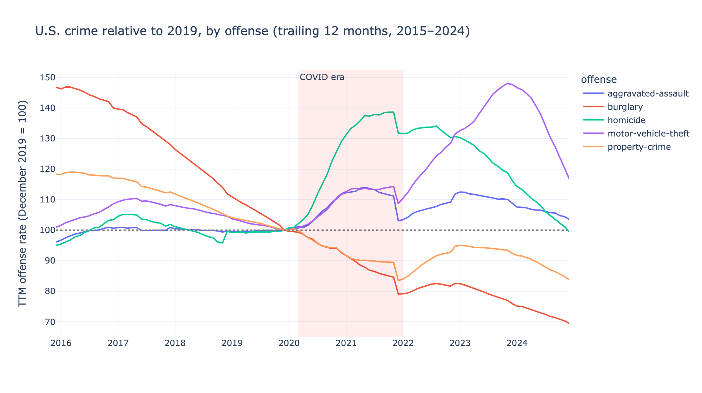
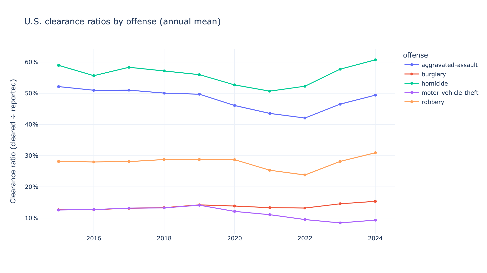
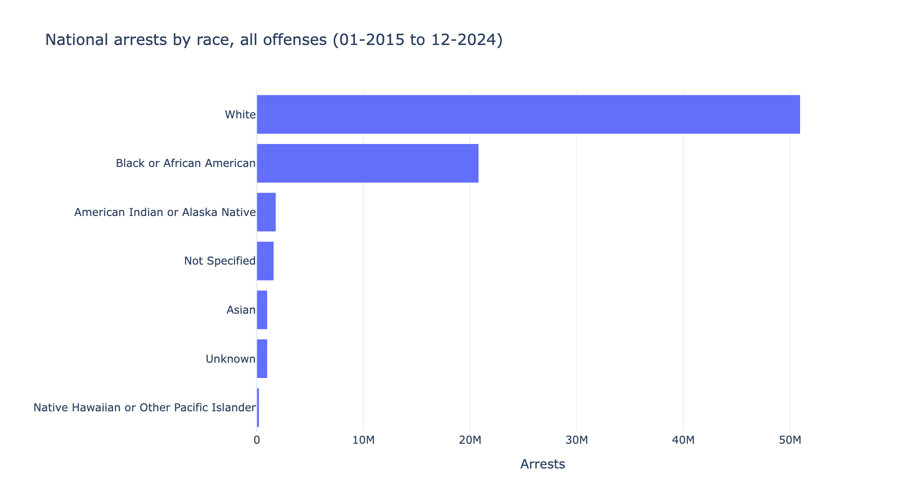
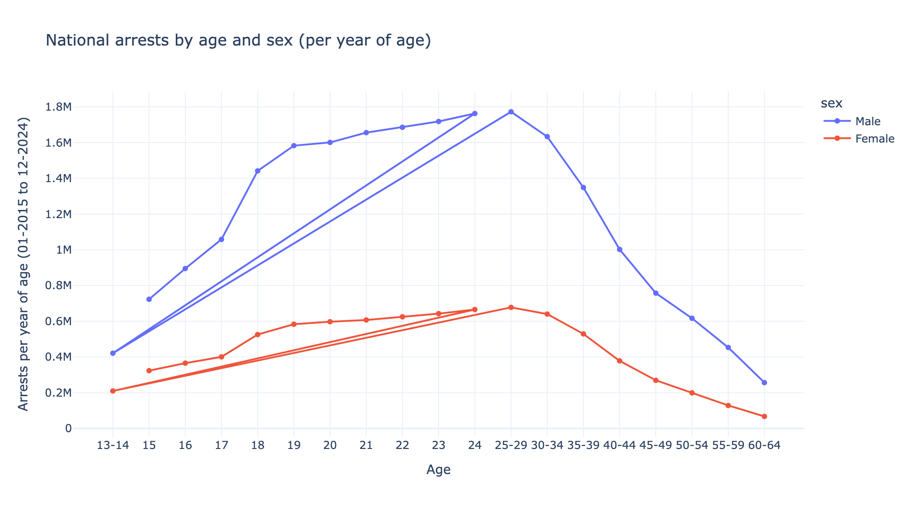

# OpenHydra — findings: U.S. crime trends, 2015–2024

National analysis over the DuckDB marts (`fct_offenses_monthly`, `fct_arrests`)
built by the [warehouse](../warehouse) layer. Source notebook:
[`notebooks/01_crime_trends.py`](notebooks/01_crime_trends.py) (paired `.ipynb`).
Charts, the plotted values ([`outputs/values.csv`](outputs/values.csv)) and the
provenance ([`outputs/provenance.json`](outputs/provenance.json)) are in
[`outputs/`](outputs).

> **Inputs.** Data release `2026-06-11-reconstructed` (FBI CDE extracts of
> 9–11 June 2026; the dates come from the project history). Observation window:
> January 2015 to December 2024. The notebook stops if the warehouse holds
> another release. The FBI revises past months, so a later release can change
> these numbers.
>
> **Definitions.** National figures. Offense series are FBI UCR rates per 100k.
> The index is the trailing-12-month rate ÷ the mean monthly rate of 2019 × 100
> (December 2019 = 100), the same definition as the dashboard. Annual clearance
> is cleared ÷ reported, both summed over the year (complete years only); a
> clearance can belong to an offense of an earlier month, so it is not a cohort
> rate. Arrest demographics are totals for all offenses over the window.

## 1. Crime did not uniformly "spike" in COVID — it split

The trailing-12-month index separates the signal from seasonality:

- **Homicide** rose to **about 139% of 2019** in late 2021, the sharpest
  violent-crime swing, then fell back to **about 99%** by December 2024.
- **Aggravated assault** peaked at **about 114%** in 2021 and ended near **104%**.
- **Motor-vehicle theft** was the late mover: it climbed to **about 148% of 2019
  in November 2023**, then fell to **about 117%** by December 2024.
- **Burglary** fell through the whole window, to **about 70%** of 2019.
  **Property crime** fell to **about 84%** and stayed there.

So the "COVID crime wave" was a **violence and auto-theft** story; property
crime and burglary continued their long-run decline.

## 2. Clearance dipped during COVID and then recovered, except for vehicle theft

- **Homicide** clearance fell from **about 59% (2015)** to **about 50% (2021)**,
  then rose to **about 60% in 2024**.
- **Aggravated assault** slid from **about 52%** to **about 42% (2022)**, then
  recovered to **about 49%**.
- **Motor-vehicle theft** clearance fell from **about 14% (2019)** to **about
  8.4% (2023)**, fewer than 1 in 11 cleared, while the offense surged (chart 1).
  It was **about 9.3%** in 2024.

## 3. Arrests by race

Totals for all offenses, January 2015 to December 2024: White about 51.0M and
Black or African American about 20.8M. Each other group is below 1.8M. The chart
uses the offense `all` only. The previous version of this chart added the rows of
all offenses together, so it counted many arrests more than once.

## 4. The age–crime curve

Normalizing the mixed single-year/5-year buckets to **arrests per year of age**
recovers the classic age–crime curve: arrests rise sharply through the late teens,
**peak at 25–29**, then decline steadily. Male arrests run **~2.7× female** across
the whole curve.

---

*Reproduce:* run `make setup data notebook` at the repository root. `make data`
builds the warehouse from the committed release, and `make notebook` writes the
charts, `values.csv` and `provenance.json`.
